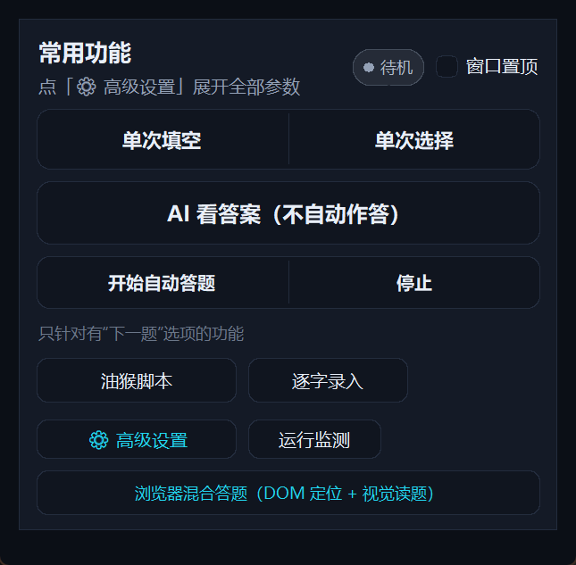
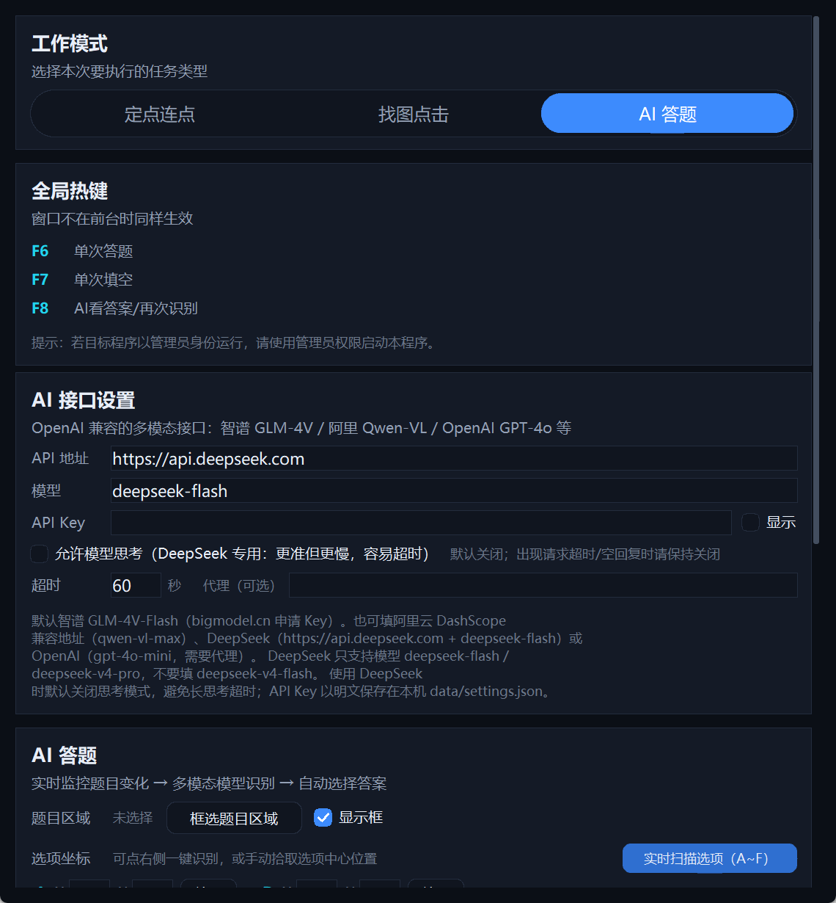
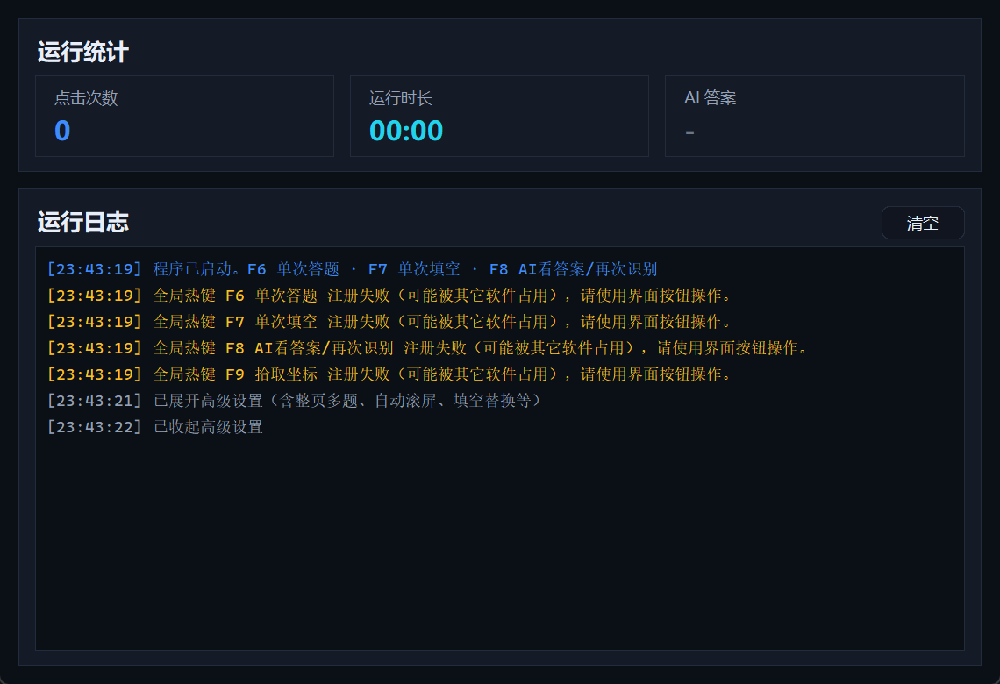
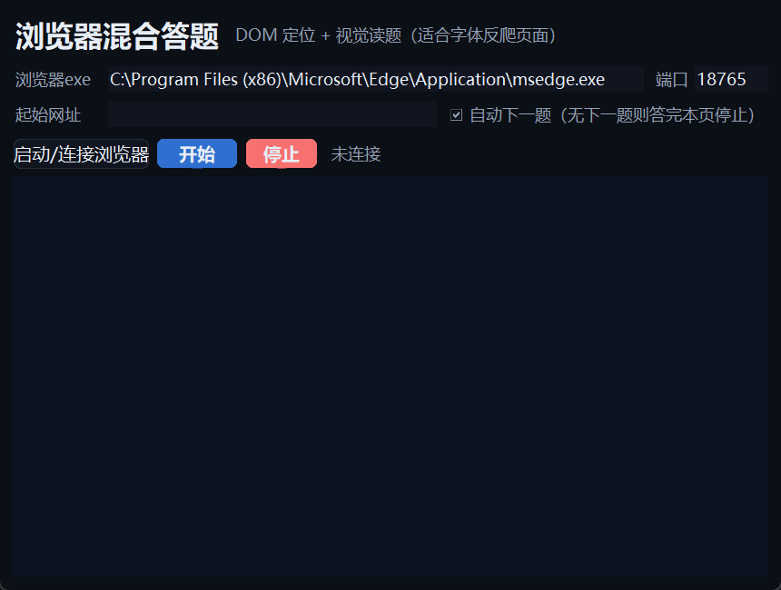
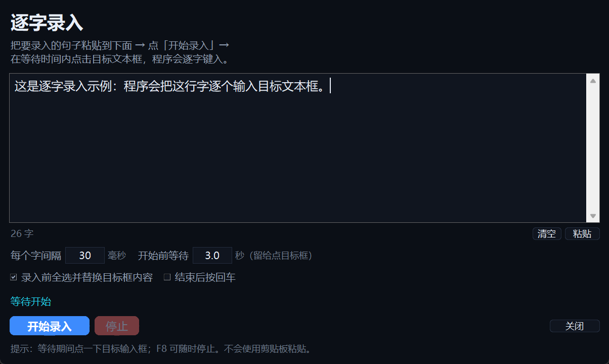

# ATanswer（Windows 版）

> ATanswer 是一个桌面答题辅助工具：支持截图 AI 看答案、单次填空/选择、自动答题，以及浏览器混合答题（DOM 定位 + 视觉读题）。
>
> 浏览器混合答题适合字体反爬页面：选项和输入框通过 DOM 操作，题目内容由 AI 视觉模型读取。

## 0. 下载

### 默认下载（推荐）

**便携版**：不需要安装 Python、requests、websocket-client 或 VC++ 运行库。

[下载 ATanswer-Portable-Windows-x64.zip](https://github.com/zit0ng/ATanswer/releases/latest/download/ATanswer-Portable-Windows-x64.zip)

解压整个文件夹后，双击 `ATanswer.exe` 或 `启动.bat`。

> 便携版必须保留 `ATanswer.exe` 和旁边的 `_internal` 文件夹，不要只把 exe 单独拖出来。

### 其他版本

**源码版**：适合已经安装 Python 3.11+、想自行修改或二次开发的用户。

[下载 ATanswer-Source-Windows-v1.0.0.zip](https://github.com/zit0ng/ATanswer/releases/latest/download/ATanswer-Source-Windows-v1.0.0.zip)




| 高级设置 | 运行监测 | 浏览器混合答题 |
| --- | --- | --- |
|  |  |  |



---

## 1. 功能一览

| 功能 | 说明 |
| --- | --- |
| 定点连点 | 在指定坐标按固定间隔 / 随机区间重复点击；支持左/右/中键、单击/双击、次数限制、开始延迟、点击后还原鼠标位置 |
| 找图点击 | 从屏幕截取或选择模板图片，在屏幕（或自定义区域）中匹配，找到后点击匹配中心；支持相似度、轮询间隔、点击偏移 |
| **浏览器混合答题（默认）** | 独立窗口连接 Edge/Chrome，用 DOM 定位选项、输入框和下一题按钮，用 AI 视觉模型分段读取题目；支持单选、多选、UEditor 多空填空、单页多题；已选选项自动跳过；不需要 Python 以外的浏览器驱动 |
| 选区框显示 | 框选「题目区域 / 搜索区域」后可在屏幕上持续显示一个置顶、鼠标穿透的矩形框，并可用「显示框」勾选随时开启/关闭 |
| 单次答题 / 单次填空 | 主界面的双段按钮：左半边「单次填空」= 框选一次→自动填空；右半边「单次选择」= 框选一次→自动点选答案；都是一次性的，不启动实时监控 |
| 逐字录入 | 输入一句话，点开始后等待几秒，让程序把它**逐字打进你点中的目标文本框**；不经过剪贴板，适合禁止粘贴的页面；支持速度、开始前等待、覆盖/回车等选项 |
| 简洁主窗口 | 默认只显示「单次填空 / 单次选择 / AI 看答案 / 开始自动答题 / 油猴脚本 / 逐字录入 / 高级设置 / 运行监测 / 浏览器混合答题」；高级设置和运行监测使用独立窗口 |
| 自动滚屏 | 勾选「自动滚屏答题」后程序会边向下滚动边识别并作答，单题/多题、单选/多选都支持，滚到底部自动停止 |
| 大区域分块识别 | 全屏题目多时把截图切成带重叠的 2×2 小块分别发给 AI，避免整屏压缩后字太小导致多选题漏选、填空题答案不完整；默认开启，可关闭换速度 |
| 油猴网页文字模式 | 普通网页答题平台可安装 `tools/tampermonkey_quiz.user.js`，直接读取页面 DOM 文字交给 AI，**不用截图、批量一页一次请求**，速度最快；支持单选/多选/填空 |
| 窗口自动隐藏 | 框选题目区域时临时隐藏主窗口；连续任务开始后最小化且不自动弹出；单次答题/填空执行期间最小化、结束后自动恢复 |
| 坐标拾取 | 3 秒倒计时自动记录鼠标位置，点击可立即确认，ESC 取消（也可用全局热键 F9） |
| 区域框选 | 全屏截图后拖动框选搜索区域 / 截取模板区域 |
| 识别测试 | 立即点"测试识别"，弹出带标记框的截图预览，显示相似度、耗时、坐标 |
| 全局热键 | F6 开始、F7 暂停/继续、F8 停止、F9 拾取坐标（窗口不在前台也生效） |
| 深色界面 | 高 DPI（Per-Monitor V2）适配，150% 缩放下文字清晰 |
| 设置持久化 | 参数、模板路径、窗口置顶等自动保存到 `data/settings.json` |
| 管理员提示 | 底部显示当前权限；一键"以管理员身份重启"，解决目标程序以管理员运行时无法模拟输入的问题 |

---

## 2. 快速开始

### 环境要求

- Windows 10 / 11（64 位）
- Python 3.10+（推荐 3.13，安装时勾选 "Add python.exe to PATH"）
- 不需要 `pip install` 任何东西

### 运行

```text
双击「启动.bat」
```

或者命令行：

```bat
cd ATanswer
python main.py
```

首次运行会自动创建 `data/` 目录（设置、模板、日志）。

> `启动.bat` 会依次寻找系统 Python / py 启动器 / 本机已安装的 Python；
> 若提示找不到 Python，请先安装 Python 或修改 bat 中的路径。

---

## 3. 使用说明

### 3.1 定点连点

1. 切换到「定点连点」。
2. 点击「拾取坐标」，把鼠标移到目标位置后：
   - 直接点击左键立即确认；或
   - 等待 3 秒倒计时结束自动记录当前位置。
3. 设置鼠标按键、点击方式、点击间隔（可勾选"随机浮动"设置区间）、次数限制（0 = 无限）、开始延迟。
4. 点击「开始执行 (F6)」。运行中可「暂停 (F7)」「停止 (F8)」；全局热键同样有效。

### 3.2 找图点击

1. 切换到「找图点击」。
2. 准备模板（二选一）：
   - 「从屏幕截取」：拖动框选屏幕上的图标 / 文字 / 按钮，自动保存为 PNG 并显示缩略图；
   - 「选择图片」：选择已有的 PNG / BMP 模板文件（推荐用本程序截取的模板，分辨率完全一致）。
3. 可选：把搜索区域从「全屏」改为「自定义区域」并点「框选区域」，减少误匹配、提升速度。
4. 调整相似度（默认 90%）与轮询间隔（默认 500 ms）。
5. 点「测试识别」查看识别位置与相似度；确认无误后点「开始执行」。

模板质量提示：若模板特征太少（几乎纯色、对比度很低），程序会提示重新框选；应尽量包含文字、图标、边框等稳定特征。

### 3.3 浏览器混合答题（默认方式）

> 默认推荐使用浏览器混合答题：用 DOM 定位选项、输入框和下一题按钮，用 AI 视觉模型读取题目内容，速度更快，也能处理字体反爬页面。

#### 适用场景

- 学习通、普通网页题库；
- 选择题、多选题、填空题；
- 一页多题、没有「下一题」的页面；
- 字体反爬页面（DOM 文字乱码，但屏幕上的字形正常）。

#### 操作步骤

1. 在主窗口点击 **「浏览器混合答题」**，打开独立窗口。
2. 确认浏览器路径默认是：

   ```text
   C:\Program Files (x86)\Microsoft\Edge\Application\msedge.exe
   ```

   端口默认：

   ```text
   18765
   ```

3. 在「起始网址」里填**完整答题页地址**，例如：

   ```text
   https://mooc1.chaoxing.com/mycourse/studentstudy?chapterId=...
   ```

   不要只填 `c=...` 这种半截参数。
4. 点击 **「启动/连接浏览器」**。
5. 程序会打开一个**独立的 Edge 调试窗口**。请在这个新窗口里打开答题页；如果你已经在第 3 步填了完整网址，程序会直接打开。
6. 回到混合答题窗口，再点一次 **「启动/连接浏览器」**，状态显示：

   ```text
   已连接
   ```

7. 点击 **「开始」**。程序会自动：

   ```text
   扫描 DOM
   → 分段截图并请求 AI 识别题目
   → 点击选项 / 填写输入框 / 填写 UEditor 多空题
   → 自动点击「下一题」
   → 循环直到停止
   ```

8. 需要结束时点击 **「停止」**。

> 如果程序打开的 Edge 只有新标签页，日志会提示：
>
> `浏览器当前只有新标签页，请先在这个浏览器里打开答题页面；再点击「启动/连接浏览器」按钮，显示已连接后点击「开始」即可。`
>
> 注意：必须使用程序打开的那个 Edge 窗口，你原来的 Edge 窗口不算。

#### 单页多题 / 没有下一题

页面上的题目全部堆在一页、没有「下一题」也可以正常使用。

程序会：

- 分段识别整页题目；
- 一次答完本页所有能识别的选择题；
- 自动填写 UEditor 多空题；
- 找不到「下一题」时，按单页模式停止。

#### 已选选项处理

- 单选题、多选题都支持；
- 已经选中的选项会跳过；
- 多选题只补选未选中的选项，例如答案 `ABCD`、已选 `AB`，只补 `C`、`D`。

#### AI 配置

浏览器混合答题和截图模式共用「高级设置」里的 AI 接口配置：

- API 地址；
- 模型；
- API Key；
- 超时 / 代理。

默认配置使用 DeepSeek：

```text
https://api.deepseek.com
deepseek-flash
```

#### 按钮颜色

- **启动/连接浏览器**：浅绿色
- **开始**：浅蓝色
- **停止**：浅红色

#### 备用方式

如果页面使用 Canvas、跨域 iframe 或完全无法定位 DOM，可以改用：

- **AI 看答案**：只显示答案，不自动点击；
- **单次选择 / 单次填空**：框选一次，答一次；
- **开始自动答题**：适合有「下一题」按钮的页面。

### 3.3.1 更快方案：油猴脚本直接读网页文字

如果答题平台是**普通网页**（题目是 DOM 文字，不是图片/Canvas），截图+视觉识别不是最快的办法。项目里提供了一个油猴脚本：

**`tools/tampermonkey_quiz.user.js`**

它直接读取页面文字（题干、选项、输入框），把整页题目一次性发给 AI，然后按 DOM 元素点击/填写答案——**不用截图上传、不用视觉模型、不用算坐标**，速度通常比截图模式快一倍以上。

使用步骤：

1. 浏览器安装 **Tampermonkey** 扩展；
2. 在软件里点 **「油猴脚本（读网页文字，更快）」** 按钮（会打开脚本文件），或直接打开 `tools/tampermonkey_quiz.user.js`；
3. 把文件内容粘贴到 Tampermonkey 新建脚本中保存（拖进浏览器也可以安装）；
4. 修改脚本顶部 `CONFIG`：
   - `apiBase` / `apiKey` / `model`：和软件里「AI 接口设置」保持一致；
   - `disableThinking`：默认 `true`（**快速模式，速度优先**）；
   - `maxTokens`：0 = 自动（思考模式 6000，非思考 2500），题目多时可手动加到 8000；
   - `mode`：`choice` 只做选择，`fill` 只做填空，`both` 都做；
   - `autoRun`：默认 `false`（打开页面**不会**自动答题）；需要自动运行时，在面板勾选「自动运行」，或把这里改成 `true`；
   - 如果识别不到题，把 `selectors.question` / `selectors.option` 改成你平台的 class（F12 查看题目容器和选项元素的类名，逗号分隔多个选择器，例如 `.question-item, .subject`）；
5. 打开答题页，右下角会出现 **「文本答题」** 按钮，面板标题会显示版本号（v1.9.0）；按钮分成 **「开始识别」**（只分析、不点击）和 **「开始答题」**（分析后点击/填写）。需要自动运行就勾选「自动运行」。支持单选、多选、填空（多空题会按第几空分别填写）。
   - **默认是快速模式**（不深度思考）；脚本已固定使用快速模式，不再提供深度思考开关；
   - **自动运行也不记忆**：每次打开页面默认关闭；点「开始识别」/「开始答题」只做单次运行，不会打开自动运行；只有手动勾选才会持续自动答/思考。
   - 如果一按开始就看到自动运行被勾上，说明脚本没有真正更新到 v1.9.0（或页面里注入了旧脚本），以面板标题版本号为准。
   - **「停止」按钮会同时关闭自动运行**，并中止当前请求；之后不会因为页面刷新/变化又自己跑起来，除非你重新点「开始」或再次勾选自动运行。
   - 面板里的 **「查看识别文本」** 会显示最近一次发给 AI 的完整题目文本，可以和网页内容逐字对比；如果题干缺失、选项顺序不对，先把 `selectors.question` / `selectors.option` 配好。

**识别不到题目时**：点面板里的 **「扫描诊断」**，日志会显示页面里 radio/checkbox 数量、候选选项数量、iframe 数量、配置的选择器命中数。常见原因和处理：

- `radioCheckbox` 有数量但识别为 0：v1.9.0 已支持隐藏 `input`（通过 label 文字识别），仍有问题就设置 `selectors.question` / `option`；
- 平台选项是没有 input 的 `div/label`：v1.9.0 已加样式启发式；如果还识别不到，用 F12 把题目容器和选项的 class 填进 `selectors`；
- `iframes` 大于 0 且题目在 iframe 里：同源 iframe 会自动扫描；跨域 iframe 无法从外层读取，需要把脚本的 `@match` 改成 iframe 的地址，并删掉脚本头部的 `@noframes`；
- 题目是 Canvas/图片：页面 DOM 里没有文字，油猴读不到，改用软件的截图识别模式。

**填空题填不进去**（平台禁粘贴）时：v1.9.0 已支持 `contenteditable` 富文本输入框，并用 `execCommand('insertText')` 直接插入文字，不经过剪贴板；如果平台用的是更特殊的自定义编辑器、连脚本插入也被拦截，就用软件的「单次填空」——新版默认 **键盘逐字输入（SendInput，不粘贴）**，和真人打字一样，只要求平台允许键盘输入。`扫描诊断` 里的 `可编辑区域` 数量可以帮助判断页面里有没有识别到输入框。

**答案不准怎么办**：

v1.9.0 修正了准确率相关的三处：题干提取不再混入/误删选项文字、选项按**视觉位置**排序、已移除深度思考开关，固定快速模式；另外多空填空会按“第几空”分别作答。默认是**快速模式**（不思考，速度优先）；点开始会强制关闭自动运行，「开始识别」只分析不点击，「开始答题」才点击。

1. 脚本已固定快速模式，不需要再调整思考开关；
2. 点「查看识别文本」，把它和网页上的题干/选项逐字对比：如果题干缺失、选项被截断或顺序乱，按你平台 DOM 设置 `selectors.question` / `selectors.option`；
3. 选项字母是按**视觉顺序**（从上到下、从左到右）重新编号的，不依赖平台原来的字母，因此点击映射不会错；
4. 如果题目包含图片、公式渲染、图表，用户脚本只能读到 DOM 文字（可能是占位符），这类题请用软件的截图识别模式；
5. 题目一次发太多也会影响准确率，可以分页、减少一次识别的题数。

**如果「查看识别文本」和网页上肉眼看到的题目不一样**（比如页面显示“下列哪项…”，识别文本却是乱码/生僻字）：

- 这是平台用了**自定义字体反爬**：网页用自定义字体把错误 Unicode 渲染成正确字形，DOM 里存的是另一套字符，所以任何“读网页文字”的脚本、复制粘贴拿到的都不是真实题目；
- 这种平台**文本模式无法保证正确**，请改用软件的**截图识别模式**（截图发给视觉模型，模型看到的是渲染后的字形）；
- 快速验证：在网页上选中题目复制，粘贴到记事本，如果也是乱码，就确认是字体反爬。

说明：

- 脚本使用 `GM_xmlhttpRequest` 直连 AI（不需要软件在后台运行，也不需要 CORS）；
- 题目按页面 DOM 顺序编号，AI 返回题号+答案，脚本按字母找对应选项点击，不依赖坐标，页面滚动/缩放也不会点错；
- 纯图片题/Canvas 题仍然用软件的截图识别模式；
- API Key 写在脚本本地，不要把改好的脚本发给别人。

### 3.4 自动滚屏答题（长页面推荐）

如果题目很长、需要边往下滚边答：

1. 先框选题目区域（全屏识别已移除，必须框选）；
2. 勾选 **「自动滚屏答题」**（会自动打开实时监控 + 整页多题模式）；
3. 设置滚屏参数：
   - **每次滚动**：滚轮格数（默认 3，**建议 1~2**；数值越大翻得越多，太大容易跳过题目）；
   - **滚动后等待**：等待页面加载/渲染的时间（默认 400ms）；
   - **最多滚动**：0 表示不限制（滚到底部自动停），也可以设置最多滚动次数；
4. 点「开始执行」后：
   - 主窗口在开始执行时会最小化，**连续任务运行期间和结束后都不会自动弹出**；需要查看日志时手动点任务栏；
   - 单次答题 / 单次填空也会在执行期间最小化，但完成或出错后会自动恢复窗口；
   - 框选题目区域时主窗口临时隐藏，选完或取消后恢复；
   - 当前屏 → AI 识别可见的题（单选/多选都支持）→ 自动点选答案 → 向下滚动一屏 → 再识别、再作答；
   - **大区域分块识别**（默认开启）：截图会被切成带重叠的 2×2 小块分别识别，每块字更大，多选题和填空题准确率更高；关闭后变成整屏一次请求，速度更快但更容易漏选；
   - **防重复点击**：AI 会检查选项是否有选中颜色/高亮/打勾，已作答的题直接跳过；程序还会按题干 key 记录本轮答过的题，即使滚动有重叠、同一题又出现，也不会再点一次导致选项被取消；
   - 连续两次滚动都没有发现新内容，或达到「最多滚动」次数时自动停止；也可以按 F8 随时停止。

注意事项：滚屏会让每屏都请求一次 AI，长页面会产生多次调用。

### 3.5 整页多题模式（一页多题，速度更快）

如果一页里同时显示多道题（例如 1、2、3 题都在同一屏，底部一个「下一题」），不需要每题都让 AI 识别一次：

1. 框选题目区域：把**整页的题目（可以包含多道）和底部按钮**都框进去；
2. 勾选「整页多题模式」（会自动开启实时监控）；
3. 选项坐标可以不填——AI 会返回每道题选项的实时位置；只填「下一题」作为备用也可以；
4. 点「开始执行」：AI 一次请求返回页内所有未作答题的答案和位置，程序依次点击，最后点「下一题」；翻到下一页或滚动后，画面变化会自动触发下一次识别。

适合一页 2~6 道题的情况；整页多题模式会跳过已经选过答案的题，所以滚动/重复看到已答题不会重复点击。该模式同样支持**单选 + 多选混合**的页面：多选会点选全部正确选项，再继续下一题。

### 3.6 单次答题（框选一次 → 点一下 → 答一次）

「执行控制」卡片最下面是一个**双段按钮**：左半边「单次答题」，右半边「单次填空」，尺寸和「暂停/停止」按钮一样。

如果你不想开实时监控，只想“框住这一题 → 让 AI 答一次”，用左半边：

1. 在右侧「执行控制」卡片，点分割按钮的**左半边「单次答题」**；
2. 屏幕上拖出一个矩形框，框住要作答的题目（可包含多道题、多选也没问题）；
3. 松开鼠标后程序立即截图 → 请求 AI → **自动点击正确答案**，日志会显示每道题的答案和点击次数；
4. 想答下一题：**重新拖一个新框，再点一次「单次答题」**即可。

说明：

- 这个流程是**一次性的**，不会持续监控屏幕，也不会重复作答；
- 框选后的区域会自动保存为「题目区域」，方便下次使用；
- 是否点击「下一题」跟随「答完自动点下一题」勾选状态；整页多题模式、单选/多选判断都共用当前设置；
- 框选后如果不想作答，可以按 Esc 或鼠标右键取消。

### 3.7 单次填空（框选一次 → 自动填答案）

遇到填空题、简答题，用这个：

1. 在右侧「执行控制」卡片，点分割按钮的**右半边「单次填空」**；
2. 拖出矩形框，框住这一页的填空题（可以一次框多道，包含每道题的题号/题干/输入框）；
3. 松开鼠标后程序会：
   - 让 AI 按**每个空**输出「题号 + 第几空 + 答案 + 输入框位置」；
   - 按题号/第几空依次点击对应输入框，**把每个空的答案分别填进去**（不会再出现整道题的多个答案塞进同一个空）；
   - 可选自动点「下一题 / 提交」；
4. 想继续填下一页：**重新拖框，再点一次按钮**。

说明：

- 一次性的，不启动实时监控，不重复填写；
- 支持一页多道填空题、多空题（如“脂溶性维生素包括__、__、__、__四种”，会分别填 4 个维生素）；
- 默认跳过已经填过答案的空；如果之前填错了，勾选 **「单次填空覆盖已填写内容（重填之前填错的答案）」**，程序会全选原内容并重新输入每个空；
- 如果发现点击位置整体偏上/偏下一行（典型现象：所有第1空都空着、答案整体填到了下一空），用 **「填空偏移」的 Y 值**微调：向上调 -40 ~ -60 左右，再配合覆盖模式重填；
- 中文答案通过剪贴板粘贴（会临时用一下剪贴板，粘贴后自动恢复原内容），如果某些输入框不支持粘贴会自动回退为逐字输入；
- **平台禁止粘贴时**：保持勾选「填空题用键盘逐字输入（不粘贴）」，改用键盘逐字输入（OS 级按键，和真人打字一样），不再经过剪贴板；
- 填空答案准确性取决于模型和题目截图清晰度，建议先用一道题验证。

### 3.8 选区框显示（看得到自己框了哪里）

在「AI 答题」的题目区域或「找图点击」的搜索区域旁边，勾选 **「显示框」** 后，程序会在屏幕上叠加一个矩形框（带标签），并且这个框是**置顶、鼠标穿透**的——可以随时看到选区范围，又不会挡住鼠标点击：


- 勾选「显示框」→ 显示；取消勾选 → 隐藏；
- 重新框选区域后，框会自动更新到新位置；
- 切换模式时会自动只显示当前模式对应的框；
- 框只是视觉提示，不会影响 AI 截图识别和鼠标操作。

### 3.9 逐字录入（把一句话逐字打进目标文本框）


在右侧「执行控制」点 **「逐字录入…」**：

1. 在窗口里输入或粘贴要录入的句子（也可以点「粘贴」从剪贴板读取）；
2. 设置 **每个字间隔**（默认 30 毫秒）和 **开始前等待**（默认 3 秒，留给点击目标框）；
3. 点 **「开始录入」**，主窗口会自动收起；
4. 在等待时间内**点击目标文本框**，程序随后逐字键入；
5. 完成后窗口自动恢复并显示已输入字数；中途可按 **F8** 立即停止。

说明：

- 使用 Windows `SendInput` 逐字符输入，**不经过剪贴板**，所以禁止粘贴的页面也能用；中文、英文、数字、换行都支持；
- 勾选「录入前全选并替换目标框内容」（默认开）会先 Ctrl+A 再输入；取消勾选则从当前光标位置追加；
- 可选「结束后按回车」；
- 目标程序以管理员身份运行时，本程序也要用底部「以管理员身份重启」后才能输入。

### 3.10 全局热键

| 热键 | 功能 |
| --- | --- |
| F6 | 开始执行 |
| F7 | 暂停 / 继续 |
| F8 | 停止（紧急停止） |
| F9 | 拾取坐标 |

热键被其它软件占用时，程序会在日志中提示，此时使用界面按钮即可。

---

## 4. 目录结构

```text
ATanswer/
├── main.py                    # 启动入口
├── 启动.bat                    # 双击启动（无控制台窗口）
├── build_exe.bat              # 可选：打包为独立 exe（需要 PyInstaller）
├── run_tests.bat              # 运行测试
├── README.md
├── assets/
│   ├── app.ico                # 应用图标
│   └── logo.png               # 界面 Logo
├── app/
│   ├── ui.py                  # 主界面（tkinter + 自绘深色组件）
│   ├── widgets.py             # 自定义控件：圆角按钮、分段控制器、卡片、日志视图、状态胶囊等
│   ├── engine.py              # 统一点击引擎（线程、暂停/继续、限次、异常保护）
│   ├── controllers/
│   │   ├── base.py            # 控制器抽象接口（start/pause/resume/stop）
│   │   ├── pc_controller.py   # Windows PC 控制器（抓屏 + 匹配 + 点击）
│   │   └── mobile_controller.py  # 占位控制器
│   ├── winapi.py              # GDI 抓屏 / SendInput / 全局热键 / DPI / 管理员
│   ├── matcher.py             # 纯 Python 模板匹配
│   ├── ai_client.py           # OpenAI 兼容多模态接口客户端（纯 urllib）
│   ├── templates.py           # 模板图片加载、保存、质量检查
│   ├── overlay.py             # 坐标拾取器 / 区域框选器 / 选区框 HUD（全屏遮罩）
│   ├── preview.py             # 识别结果预览窗口
│   ├── hotkeys.py             # 全局热键线程
│   ├── settings.py            # 设置数据类与 JSON 持久化
│   ├── png.py                 # 极简 PNG 编解码（纯标准库）
│   └── paths.py               # 路径与数据目录管理
├── data/                      # 运行后生成：settings.json / templates / logs（可删除重建）
├── docs/                      # 说明文档截图
├── tools/
│   ├── gen_icon.py            # 生成图标（开发用，需要 Pillow）
│   ├── capture_screenshots.py # 自动生成 docs 截图（开发用，需要 Pillow）
│   ├── mock_ai_server.py      # 本地模拟 AI 接口（测试用，无需外网）
│   ├── integration_test.py    # 真实鼠标注入的端到端集成测试
│   ├── ai_integration_test.py # AI 答题端到端集成测试（模拟 AI + 真实点击）
│   ├── ai_realtime_integration_test.py  # AI 实时监控端到端测试（含手动翻页）
│   ├── ai_scroll_integration_test.py    # AI 实时选项定位测试（模拟滚动后点中正确位置）
│   ├── ai_page_integration_test.py      # 整页多题模式测试（一页 2 题含多选，一次 AI 全部答完）
│   ├── tampermonkey_quiz.user.js        # 油猴脚本：直接读网页文字作答（最快）
│   └── make_release.py        # 打包发布 zip
└── tests/                     # 单元测试（模板匹配 / 引擎 / AI / PNG / 设置 / Windows API）
```

---

## 5. 技术方案

- **界面**：tkinter 自绘深色组件，主窗口只保留常用功能，高级设置和运行监测独立窗口。
- **截图答题**：GDI BitBlt 抓屏 + AI 多模态模型识别，支持矩形框选、全屏、AI 看答案、再次识别。
- **浏览器混合答题**：Chrome DevTools Protocol 连接 Edge/Chrome，DOM 定位选项、输入框、UEditor 填空和下一题按钮；AI 只负责读题和给答案。
- **字体反爬**：题目文字由截图视觉模型读取；点击和填写仍通过 DOM 完成。
- **热键**：F6 单次答题，F7 单次填空，F8 AI 看答案/再次识别。
- **发布**：源码可直接运行；`build_exe.bat` 可打包为 exe。

### AI 答题链路

```
实时监控：不断截取题目区域并做降采样签名 → 画面变化且稳定后才请求 AI
→ 一次请求同时返回「答案字母 + 各选项当前位置 + 下一题位置」→ 点击答案对应位置
→ 记录当前画面为基线（避免重复作答）→ 可选自动点「下一题」→ 等待下一次画面变化
```

- 支持智谱 GLM-4V、阿里 Qwen-VL、OpenAI GPT-4o、DeepSeek（`deepseek-flash`）等 OpenAI 兼容多模态接口；
- 使用标准库 `urllib` + `base64`，不需要安装任何 SDK；
- 变化检测基于题目区域的降采样灰度签名，只对明显变化（如换题、滚动）触发作答；滚动/切换过程中会等待画面稳定再识别；
- 同一题不会重复请求；手动翻页模式下答完有 3 秒缓冲，避免你滚动查看时重复作答；
- **实时选项定位**：作答请求同时返回当前选项坐标，滚动后也能点中正确位置；模型若没按 JSON 返回，会自动回退到用户配置的固定坐标；
- 未配置真实 API 时，可用 `tools/mock_ai_server.py` 在本地完整验证流程（单元测试与集成测试均如此）；
- 不同模型返回格式差异（字符串 / 多段内容列表）已做兼容。

### 模板匹配原理（无 OpenCV）

1. 抓屏得到 BGRA 像素，用 `bytes[1::4]` 取**绿通道**作为灰度近似（C 速度切片）；
2. 灰度量化到 16 级（`v & 0xF0`），容忍细微色差；
3. 在模板中挑选"水平边缘最多"的若干行，切成若干段，用 `bytes.find` 做整段搜索，得到候选位置（比 `find` 整行更抗少量像素变化）；
4. 对候选逐行校验，按不匹配像素比例计算相似度；
5. 若精确搜索失败，回退到 4 级粗量化锚点搜索再做 16 级校验，提升容错；
6. 返回最佳位置与相似度。

> 该实现针对"从当前屏幕截取的 UI 元素"效果最好；复杂图片、半透明/动画元素建议配合"自定义搜索区域"使用。

---

## 6. 限制与注意事项

- **全屏独占的 DirectX 游戏**：GDI BitBlt 可能抓不到画面（黑屏）。此类场景请把游戏改成窗口化 / 无边框窗口模式。
- **权限（UIPI）**：如果目标程序以管理员身份运行，本工具的模拟输入可能被系统拦截。请使用底部「以管理员身份重启」（会弹 UAC）。普通权限下目标程序也是普通权限时不受影响。
- **多显示器**：坐标按整个虚拟桌面计算，支持副屏（可能为负坐标）；模板识别结果会换算到绝对屏幕坐标。
- **模板分辨率**：模板必须与当前屏幕的分辨率/缩放比例一致。换显示器、改缩放比例后建议重新截取模板。
- **鼠标会被占用**：连点期间程序会移动/点击鼠标，请勿同时操作电脑；可随时按 F8 停止。
- **点击间隔精度**：Windows 调度与程序轮询会带来几毫秒误差；找图模式的间隔还包含抓屏和匹配耗时，属于正常现象。
- **AI 答题依赖网络与 API Key**：模型识别准确率无法保证 100%，建议先用「测试识别」确认；API Key 明文保存在本机，请勿外传；API 调用可能产生费用。
- **AI 选项坐标是固定的**：窗口大小/分辨率/布局变化后需要重新拾取；下一题加载慢时请调大「下一题后等待」。
- **多选题**：程序会自动判断单选/多选并点选全部正确选项；多选比单选更容易受模型判断影响，建议先用「测试识别」抽几道多选题确认效果。
- **填空题**：程序会根据 AI 返回的题号和答案自动填入文本框；如果某些平台的自定义输入框不支持粘贴/输入，可能填不进去，可先用一题测试。
- **自动滚屏**：滚动会改变页面内容，如果页面包含倒计时、悬浮广告等一直在变的元素，可能影响变化检测；全屏识别请把答题窗口最大化并置于前台。
- **实时定位依赖模型返回坐标**：模型返回的位置是估算值，通常够用；极端情况下可关闭「实时定位选项坐标」使用固定坐标。
- **实时监控依赖画面变化**：请把题目区域框在"每题都会变化"的范围（题干+选项），不要包含倒计时、悬浮广告等一直变化的元素，否则可能反复触发 AI。
- **已选中选项不会重复点击**：整页多题/多选模式下，AI 会返回 `selected` 字母（蓝色按钮/高亮/勾选），程序还会对选项按钮做蓝色像素采样兜底；已经选中的正确选项会跳过，只补点未选中的选项，避免把已选项又点掉。
- **选区框 HUD**：置顶且鼠标穿透，不影响点击；只是视觉提示，不会遮挡截图内容。
- **合规使用**：AI 答题功能面向**你自己的平台、内部题库、学习/测试环境**；请勿用于他人平台的考试、测评或违反规则/法律法规的用途。使用第三方平台时请遵守其用户协议。
- 部分安全软件可能对"模拟鼠标"行为敏感，可将其加入信任列表。

---

## 7. 测试

```bat
run_tests.bat
```

或：

```bat
cd ATanswer
python -m unittest discover -s tests -t . -v
```

测试覆盖：

- 模板匹配（精确匹配、区域限制、噪声容忍、误匹配抑制、纯色模板拒绝）；
- 点击引擎（次数限制、停止、暂停/继续、出错自动停止、找图模式点击偏移）；
- AI 答题（引擎流程、实时监控去重、未知答案保护、配置校验）；
- AI 选项自动定位 / 实时定位（JSON 解析、相对坐标换算、动态坐标覆盖固定坐标、异常返回处理）；
- 单选 / 多选解析与点击（多选会依次点选全部正确选项）；
- 单次答题 / 单次填空（执行控制栏双段按钮：框选一次识别并点击/填写一次）；
- 全屏识别 / 自动滚屏（滚轮方向、滚动到底自动停、滚动次数上限、已答题高亮识别与题干去重防重复点击）；
- 大区域分块识别（2×2 带重叠切片、小区域不分块）；
- 油猴脚本（直接读网页 DOM 文字，批量请求 AI，按题号点击/填写）；
- 选区框 HUD（显示/隐藏/销毁）；
- SplitButton 双段按钮（左/右回调、禁用态）；
- AI 客户端（请求格式、图片 base64、HTTP/JSON 错误、答案解析、多段内容兼容）；
- PNG 编解码；
- 设置持久化与字段纠错（含 AI 配置字段）；
- Windows 抓屏 / 真实屏幕模板匹配 / 热键注册。

共 **97 个单元测试**（不依赖外网，AI 部分通过 `tools/mock_ai_server.py` 本地模拟）。

开发阶段还做了真实鼠标注入的端到端验证（不在正式测试内）：

```bat
python tools/integration_test.py             :: 定点连点 + 找图点击的真实点击
python tools/ai_integration_test.py          :: 本地模拟 AI + AI 模式真实点击选项/下一题
python tools/ai_realtime_integration_test.py :: AI 实时监控（自动下一题 + 手动翻页两种模式）
python tools/ai_scroll_integration_test.py   :: AI 实时选项定位（模拟滚动后点中新的正确位置）
python tools/ai_page_integration_test.py     :: 整页多题模式（一页 2 题含多选，一次 AI 全部答完）
```

> 注意：这两个脚本会移动鼠标并点击脚本自己创建的置顶测试窗口，请勿在运行中操作电脑。

---

## 8. 可选：打包为 exe

需要可联网环境安装 PyInstaller：

```bat
build_exe.bat
```

完成后 exe 位于 `dist\ATanswer\ATanswer.exe`（onedir 形式，可直接整个目录拷贝使用）。

---

## 9. 许可证

本项目使用自定义源码许可证：

- 允许个人、教育、研究等非商业用途；
- **禁止商业使用和商业二次分发**；
- 非商业转载/分发必须保留 `LICENSE`、版权声明，并注明修改；
- 商业授权需联系作者。

完整条款见 [LICENSE](LICENSE)。

> 由于限制商业使用和商业二次分发，这不是 OSI 定义的开源许可证；仓库为 source-available。
